# The maestro: a search engine for patterns

You give the maestro a request in plain words. It finds the pattern in the library that
fits, decides how much care the request needs (complexity 1-4), tailors the pattern to the
request, and shows you the result before anything runs. Like a search engine, it has an
index, a cache, a ranker and a results page. Unlike most search engines, it is itself a
pattern played by the same engine, so every decision is recorded and replayable.

| Search engine | Maestro | Where |
|---|---|---|
| Query | Your request, kept verbatim as the goal | `request` |
| Cache of past queries | Approved compositions for the same request: reused without a debate | `.symphony/memory.json` → `compositions` |
| Keyword index | Each pattern's `verbTriggers` ("fix", "bug", "refactor", "investigate"…); the opening verb counts twice | `patterns.route` tool |
| Ranker | The classifier (AI) confirms the pattern, or `new` when nothing fits, and rates complexity | `classify` |
| Related results | The three closest approved compositions, shown to the classifier and proposer as precedent | `pastCompositions` |
| Tailoring the result | An `adaptation`: guidance added to specific AI steps and new settings. The tested steps stay as they are | `adaptation` |
| Quality check | A debate sized by complexity, deterministic validation, requirement coverage | debate, `validate`, `cover` |
| Results page | The go-gate: you approve, give feedback, or stop | `gate` |

When you approve, the composed score runs as its own linked run (see `composedScore`), at
the final complexity, with your request as its goal.

## The flow

1. **Recall.** The same request (ignoring case and spacing) approved before, on a pattern
   that has not changed since, is reused: no classification, no debate, straight to the
   go-gate, marked as reused.
2. **Route.** The library is listed, verb triggers suggest a pattern, and the classifier
   confirms it (or picks another, or `new`), rates complexity and lists the request's
   explicit **requirements**. A complexity you set (`--complexity`, the toolbar, MCP) wins;
   the classifier's own rating is kept as `ratedComplexity`. A request that needs two
   patterns in a row (investigate, then backlog what it found) sets `thenPattern`.
3. **Debate, sized by complexity.**

   | Complexity | Who takes part |
   |---|---|
   | 1 | Nobody when a library pattern fits as is; a proposer for `new` |
   | 2 | Proposer + skeptic |
   | 3 | + pragmatist (triages every concern as REAL or THEORETICAL) |
   | 4 | + template-critic (CORRECT, WRONG or HYBRID; may reroute to another pattern once) |

   The conductor (`revise`) folds the debate into one adaptation, or one draft for `new`.
   With no concerns, the pragmatist and the conductor are skipped below tier 4.
4. **Validate.** The adaptation applied to the tested pattern (or the new draft) is checked
   by code. Errors go back to the conductor with the error list, without a new debate.
5. **Check requirements.** Each requirement (the request's own, plus every piece of go-gate
   feedback so far) is mapped to the step that meets it, or marked NOT COVERED. Uncovered
   ones go back to the proposer while rounds remain.
6. **Read inputs** for the pattern from the request, then **log** what was done (below).
7. **Go-gate.** Approve to perform. Feedback starts another round (one tier up only if you
   tick *smarter*). Feedback after the last round (`maxRounds`) is never dropped: the run
   ends partial and keeps it as `unappliedFeedback`.
8. **Remember** the approved composition, then perform it.

```mermaid
flowchart TD
  n_start(["Start"])
  n_notePreset["Note preset tier"]
  n_library[/"🔧 Read the library"/]
  n_route[/"🔧 Match verbs"/]
  n_recall[/"🔧 Recall compositions"/]
  n_hasRemembered{"Composed before?"}
  n_reuse["Reuse composition"]
  n_classify["🤖 Route and classify"]
  n_keepPreset["Preset tier wins"]
  n_load["Load template"]
  n_outline[/"🔧 Outline template"/]
  n_debate{"Debate needed?"}
  n_propose["🤖 Proposer"]
  n_hasSkeptic{"Skeptic? (≥2)"}
  n_skeptic["🤖 Skeptic"]
  n_concerns{"Anything to change?"}
  n_hasPragmatist{"Pragmatist? (≥3)"}
  n_pragmatist["🤖 Pragmatist"]
  n_hasCritic{"Template-critic? (4)"}
  n_critic["🤖 Template-critic"]
  n_reroute{"Reroute?"}
  n_switch["Switch pattern"]
  n_revise["🤖 Conductor"]
  n_validate[/"🔧 Validate score"/]
  n_valid{"Valid?"}
  n_roundsLeft{"Rounds left?"}
  n_retry["Fix errors (conductor)"]
  n_hasRequirements{"Requirements to check?"}
  n_cover["🤖 Check requirements"]
  n_covered{"All covered?"}
  n_coverRoundsLeft{"Rounds left?"}
  n_requeue["Back to the proposer"]
  n_context["🤖 Read inputs"]
  n_gate{{"👤 Go-gate"}}
  n_escalate["Escalate"]
  n_logComposition["Log the composition"]
  n_logGaveUp["Log the composition"]
  n_finalize["Final score"]
  n_remember[/"🔧 Remember composition"/]
  n_done(["Score composed · success"])
  n_gaveUp(["No valid score · failed"])
  n_stopped(["Stopped · partial"])
  n_outOfRounds["Out of rounds"]
  n_feedbackUnapplied(["Out of rounds: feedback not applied · partial"])
  n_start --> n_notePreset
  n_notePreset --> n_library
  n_library --> n_route
  n_route --> n_recall
  n_recall --> n_hasRemembered
  n_hasRemembered -->|"yes"| n_reuse
  n_hasRemembered -->|"no"| n_classify
  n_reuse -->|"composed before"| n_outline
  n_classify --> n_keepPreset
  n_keepPreset --> n_load
  n_load --> n_outline
  n_outline --> n_debate
  n_debate -->|"yes"| n_propose
  n_debate -->|"pattern fits as is"| n_validate
  n_propose --> n_hasSkeptic
  n_hasSkeptic -->|"yes"| n_skeptic
  n_hasSkeptic -->|"no"| n_validate
  n_skeptic --> n_concerns
  n_concerns -->|"yes"| n_hasPragmatist
  n_concerns -->|"the proposal stands"| n_validate
  n_hasPragmatist -->|"yes"| n_pragmatist
  n_hasPragmatist -->|"no"| n_revise
  n_pragmatist --> n_hasCritic
  n_hasCritic -->|"yes"| n_critic
  n_hasCritic -->|"no"| n_revise
  n_critic --> n_reroute
  n_reroute -->|"yes"| n_switch
  n_reroute -->|"no"| n_revise
  n_switch -.->|"rerouted"| n_outline
  n_revise --> n_validate
  n_validate --> n_valid
  n_valid -->|"yes"| n_hasRequirements
  n_hasRequirements -->|"yes"| n_cover
  n_hasRequirements -->|"no"| n_context
  n_cover --> n_covered
  n_covered -->|"yes"| n_context
  n_covered -->|"no"| n_coverRoundsLeft
  n_coverRoundsLeft -->|"requirements not met"| n_requeue
  n_coverRoundsLeft -->|"out of rounds: shown at the go-gate"| n_context
  n_requeue -.->|"meet the requirements"| n_propose
  n_valid -->|"no"| n_roundsLeft
  n_roundsLeft -->|"yes"| n_retry
  n_roundsLeft -->|"no"| n_logGaveUp
  n_logGaveUp --> n_gaveUp
  n_retry -.->|"fix errors"| n_revise
  n_context --> n_logComposition
  n_logComposition --> n_gate
  n_gate -->|"feedback"| n_escalate
  n_gate -->|"feedback, no rounds left"| n_outOfRounds
  n_gate -->|"approved"| n_finalize
  n_outOfRounds --> n_feedbackUnapplied
  n_gate -->|"rejected"| n_stopped
  n_escalate -.->|"next round"| n_propose
  n_finalize --> n_remember
  n_remember --> n_done
```

<!-- flow:maestro -->
<!-- Generated from src/patterns by `npm run docs`: edit the pattern, not this block. -->



<!-- /flow:maestro -->

## Why it adapts instead of rewriting

A library pattern is tested: its steps, edges and checks are covered by scripted tests and
evals. Rewriting it per request cost up to 138k output tokens and 15-24 minutes, and
sometimes dropped tested steps silently. So for a library pattern the debate reads a compact
outline and writes only an adaptation:

```json
{
  "directives": { "hypothesize": "It fails about once in ten CI runs: include timing races." },
  "initial": { "maxAttempts": 2 }
}
```

A full draft is written only for `new`, or when the shape truly has to change and the
proposer says why.

## The log: what it did, not only what it made

When the maestro finishes (or stops at the go-gate, or gives up), its result is a log the
engine writes from the state, so it cannot differ from what happened:

| Field | What it says |
|---|---|
| `composition` | One line per decision: the pattern and how it was chosen (reused, library as is, tailored, new), what the verb triggers suggested, a reroute by the critic, the then-pattern, the complexity (and the classifier's rating when you set it), why, rounds used, last validation errors. |
| `requirements` | The ledger: the request's requirements and every piece of feedback. |
| `coverage`, `uncovered` | Which step meets each requirement, and which none does. |
| `debateNotes` | Approach, what was debated, open doubts. |
| `adaptation` | Exactly what was changed in the tested pattern. |
| `unappliedFeedback` | Feedback the rounds ran out before applying. |

It appears at the go-gate, at the end of `npm run cli -- maestro "…"`, in the studio's result
panel and in MCP's `get_run`. Example:

```text
### composition

- Pattern: fix (the tested library pattern, tailored)
- Verb triggers suggested: fix
- Complexity: 3
- Why: Verb match 'fix'; flaky behaviour makes it riskier than routine.
- Rounds: 1 of 6
```

## Debugging a composition

| Symptom | Look at |
|---|---|
| Wrong pattern | `composition`: what the verb triggers suggested and the classifier's reason. A request that opens with a verb ("investigate …") counts that verb twice. |
| Same request, different routes | `npm run cli -- rehearse maestro -n 5 -c request="…" --fields chosen,complexity`: per-field agreement over N runs. |
| A requirement was lost | `coverage` / `uncovered` at the go-gate; give it as feedback and it joins the ledger for every later round. |
| Too expensive | Set `--complexity` lower: fewer debaters, a cheaper model per tier. The go-gate remains the backstop. |
| Compose without running | `npm run cli -- maestro "…" --compose-only` (add `--save` to write the score to `src/patterns/drafts/`). |

See also: [how the studio works](./studio.md) and [the algorithm flows](./patterns.md).
