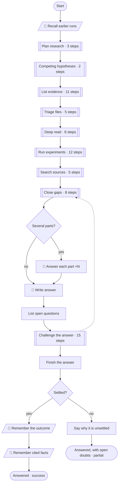
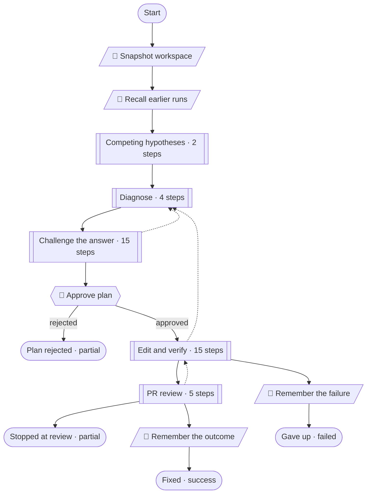
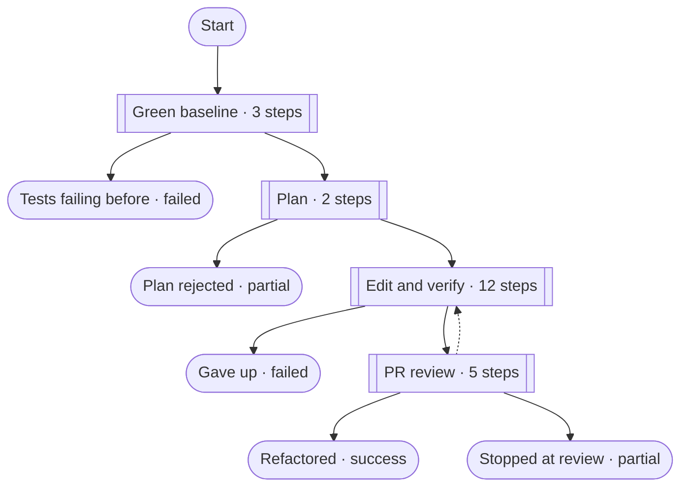
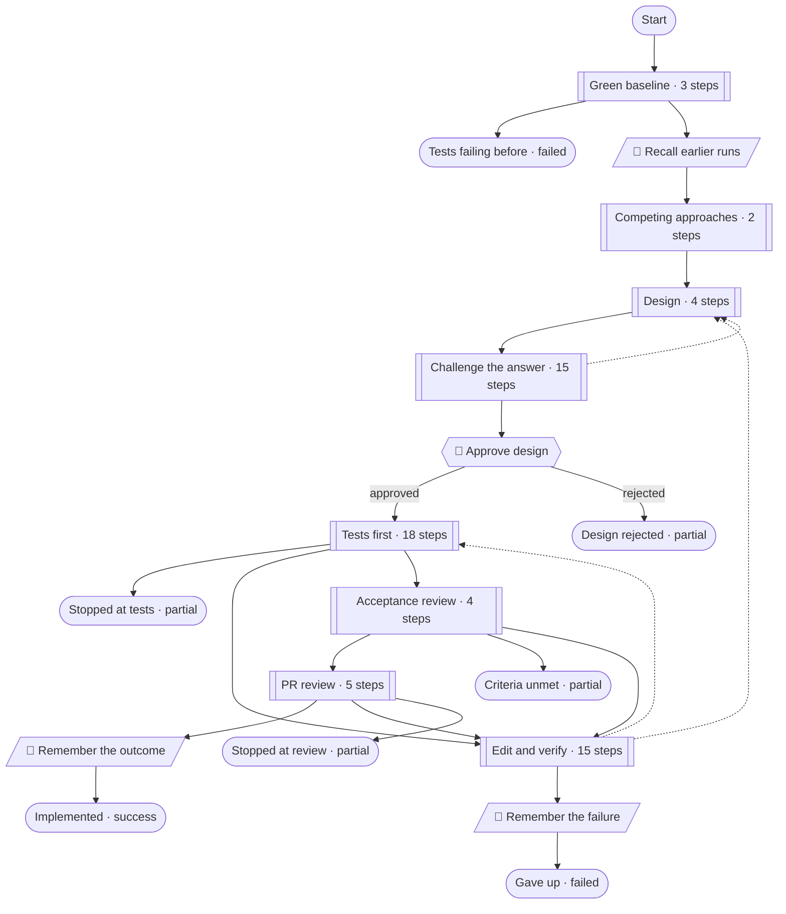
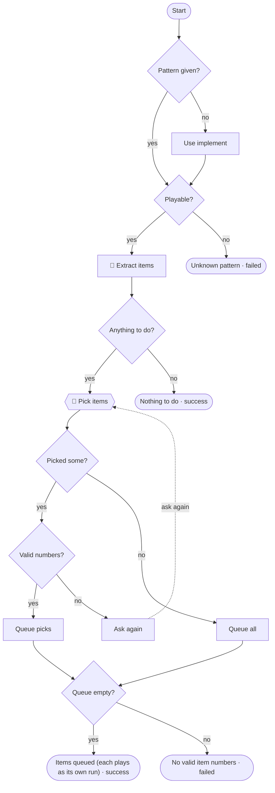
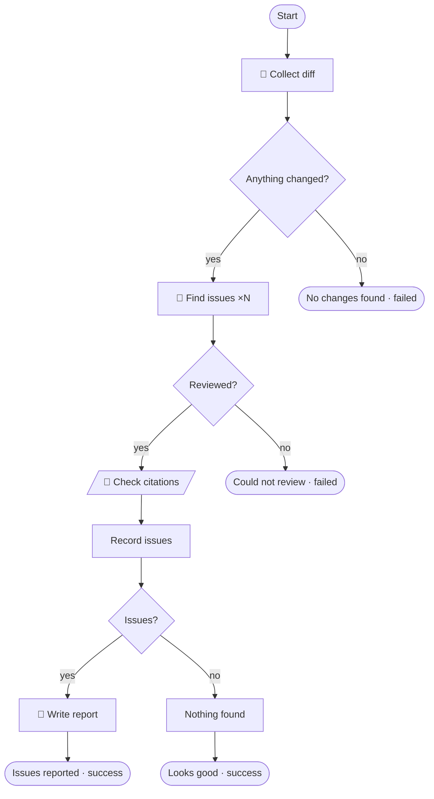
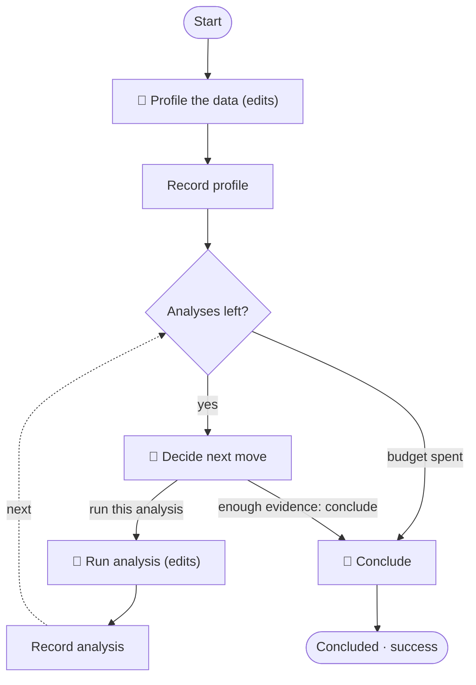

# The algorithm flows

Each pattern is a TypeScript file in [`src/patterns/`](../src/patterns). The diagrams below
are generated from those files by `npm run docs` (a test fails when they are out of date),
with each phase drawn as one box; the table under a diagram lists the steps inside each
phase. In the studio, click ⊕ on a phase to open it.

Legend: 🤖 an AI step (*edits* = an executor that may change files; ×N = split into parallel
sub-agents) · 🔧 a tool the engine runs · 👤 your approval · ◇ a condition the engine
evaluates · plain boxes are engine computations · dashed arrows go back (loops, all bounded).

Shared building blocks (in [`src/patterns/phases/`](../src/patterns/phases)):

| Phase | Used by | What it guarantees |
|---|---|---|
| Competing hypotheses | investigate, fix, implement | At least 3 rival explanations (2 for a routine problem), one of them "none of these" or "the premise is wrong", before any evidence is read. |
| Evidence and citations | investigate, fix, implement, review | Every finding cites `path:line` with a quote, or a URL / named source. The engine checks file citations; failures go to `unverified`, not into the answer. |
| Challenge (debate) | investigate, fix, implement | By complexity: a skeptic (≥2, at most 5 objections, no repeats of earlier rounds), a pragmatist who triages each one as REAL or THEORETICAL with a cited reason (≥3), a second independent investigator (4). REAL objections go back to research, bounded by `maxDebateRounds`; those still open at the cap are reported. |
| Edit and verify | fix, refactor, implement | An executor edits; the engine captures the diff (an edit that changed nothing is caught), runs the tests and the linter, and triages failures: environment, wrong diagnosis (back to research), or try again, bounded by `maxAttempts`. |
| PR review | fix, refactor, implement | A reviewer reads the diff; blocking comments go back to editing, bounded; you can accept despite the review. |

---

## investigate

Answer a question with evidence, from whatever sources it needs: workspace files, web pages,
experiments, git history, GitHub, dependencies, MCP servers.

1. **Recall and plan.** Facts and lessons from earlier runs are recalled and re-checked
   against today's files. The planner splits the question into sub-questions, decides for
   every available source whether it can hold evidence (a reason for each skip), chooses
   how many sub-agents to use (1-6), and may split the question into independent parts.
2. **Hypotheses.** Competing answers before any evidence, each with what would confirm or
   refute it. The engine keeps a tally per hypothesis (`hypothesisStatus`: findings for and
   against, *untested*, *challenged*) after every batch, and later steps steer by it.
3. **List evidence.** Only what the plan needs. A large repository is searched first
   (locate) instead of triaging every file, unless `exhaustive` is set.
4. **Triage → deep read.** Files are read whole by the engine (`preload`) and given to
   sub-agents in parallel batches; an answer that skips a file of its batch is rejected. A
   file the engine could not read is named in the prompt so the step reads it with tools.
   Every relevant file and page is then read completely. Unreadable items are retried once
   at the end, except PDFs and binaries, which would fail the same way.
5. **Experiments** (after your approval) and **source searches**, in parallel.
6. **Close gaps.** Sub-questions the findings do not answer get targeted research, then a
   question to you for a hint.
7. **Answer.** Cited by finding id, one answer per sub-question (or OPEN), one ruling per
   hypothesis. The engine appends a coverage section: files not triaged, pages, experiments,
   what could not be read, sources searched and skipped, findings taken on trust.
8. **Challenge.** The debate above; REAL objections reopen research.
9. **Settle.** A settled answer ends `success` and remembers a lesson and the findings it
   cited. Open objections or low confidence end `partial`, with the reason, and teach nothing.

<!-- flow:investigate -->
<!-- Generated from src/patterns by `npm run docs`: edit the pattern, not this block. -->

| Phase | What it does | Steps |
| --- | --- | --- |
| Plan research | Available sources, sub-questions, which evidence applies | List sources → Plan research → Queue sources |
| Competing hypotheses | Every plausible explanation, each with what would confirm or refute it; how hard it is | Propose hypotheses → Set complexity |
| List evidence | Only what the plan needs: workspace files (a big repo is searched first), web pages, experiments | Workspace? → List every file → Count files → Triage every file? → Queue files → Locate files → Queue located files → Web? → List web pages → Experiments? → Design experiments |
| Triage files | Every listed file, in batches | Files left? → Next batch → Triage files → Check citations → Record triage |
| Deep read | Every relevant file and listed page, completely | Queue deep reads → Deep reads left? → Next deep batch → Deep read → Check citations → Record deep read → Retry unreadable? → Queue unreadable again |
| Run experiments | With your approval, run and measure | Experiments listed? → Allow experiments? → Queue experiments → Untimed experiments? → Run experiments side by side → Check citations → Record experiments → Timed experiments left? → Next experiment → Run timed experiment → Check citations → Record experiment |
| Search sources | History, GitHub, dependencies, MCP | Sources left? → Next source → Search source → Check citations → Record source |
| Close gaps | Targeted research, then a human hint | Find gaps → Chase gaps? → Close gaps → Check citations → Record gap research → Good enough? → Ask for a hint → Use hint |
| Challenge the answer | Skeptic, pragmatist and a second investigator, scaled by complexity | Skeptic? (≥2) → Skeptic → Objections? → Research them? (rounds left) → Report open objections → Pragmatist? (≥3) → Pragmatist → Keep every objection → Real objections? → Research objections → Second investigator? (4) → Second investigator → Check citations → Record its evidence → Reconcile |

<!-- /flow:investigate -->

## fix

Fix a bug: the diagnosis comes from evidence, you approve it, and the engine (not the AI)
decides whether the tests pass.

1. **Recall, hypotheses, evidence.** Like investigate, focused on the symptom.
2. **Diagnose** a root cause from the cited evidence; the challenge phase attacks it.
3. **👤 Approve the plan** (root cause, files, the change, the test).
4. **Edit and verify.** A failure triaged as a wrong diagnosis goes back to research for a
   new diagnosis (bounded); an environment problem (not the code) gives up with that
   reason instead of editing further.
5. **PR review**, then remember the outcome (fixed, or why it failed).

<!-- flow:fix -->
<!-- Generated from src/patterns by `npm run docs`: edit the pattern, not this block. -->

| Phase | What it does | Steps |
| --- | --- | --- |
| Competing hypotheses | Every plausible explanation, each with what would confirm or refute it; how hard it is | Propose hypotheses → Set complexity |
| Diagnose | Evidence for and against every hypothesis, then the root cause | Gather evidence → Check citations → Record evidence → Diagnose |
| Challenge the answer | Skeptic, pragmatist and a second investigator, scaled by complexity | Skeptic? (≥2) → Skeptic → Objections? → Research them? (rounds left) → Report open objections → Pragmatist? (≥3) → Pragmatist → Keep every objection → Real objections? → Research objections → Second investigator? (4) → Second investigator → Check citations → Record its evidence → Reconcile |
| Edit and verify | Edit; the engine diffs and runs the tests; failures are triaged | Edit → Capture diff → Anything new? → No progress → Run tests → Lint? → Run lint → Count attempt → Tests pass? → Attempts left? → Triage failure → Environment? → Diagnosis wrong? → Diagnose again? → Back to diagnosis |
| PR review | Review the change; blocking comments go back to editing until approved | PR review → Approved? → Review again? → Back to editing → Accept despite review? |

<!-- /flow:fix -->

## refactor

Restructure code without changing behaviour. The tests are the oracle: they must pass
before anything changes and after.

1. **Green baseline.** The engine runs the tests first; a red baseline stops the run (a
   refactor cannot prove it preserved behaviour that was already broken).
2. **Plan** the files, steps and the invariants that must not change; **👤 approve** it.
3. **Edit and verify** against the invariants. Bugs noticed on the way are reported
   (`noticedBugs`), not fixed.
4. **PR review.**

<!-- flow:refactor -->
<!-- Generated from src/patterns by `npm run docs`: edit the pattern, not this block. -->

| Phase | What it does | Steps |
| --- | --- | --- |
| Green baseline | Tests must pass before anything changes | Run tests first → Green? → Snapshot workspace |
| Plan | Files, steps and the behaviour that must not change | Plan refactoring → Approve plan |
| Edit and verify | Edit; the engine diffs and runs the tests; failures are triaged | Edit → Capture diff → Anything new? → No progress → Run tests → Lint? → Run lint → Count attempt → Tests pass? → Attempts left? → Triage failure → Environment? |
| PR review | Review the change; blocking comments go back to editing until approved | PR review → Approved? → Review again? → Back to editing → Accept despite review? |

<!-- /flow:refactor -->

## implement

Build a feature. Passing tests are not enough: every acceptance criterion must be met, with
evidence.

1. **Baseline** tests, then **competing approaches** (the hypotheses phase) and evidence
   from the code.
2. **Design** with acceptance criteria; the challenge phase attacks it; **👤 approve** it.
3. **Tests first.** Tests written before the code must fail, for the right reason; then they
   are locked, and the engine checks that edits leave them untouched.
4. **Edit and verify** against the locked tests.
5. **PR review**, then an **acceptance review**: each criterion met, with evidence, or the
   edit goes back (bounded).

<!-- flow:implement -->
<!-- Generated from src/patterns by `npm run docs`: edit the pattern, not this block. -->

| Phase | What it does | Steps |
| --- | --- | --- |
| Green baseline | Tests must pass before anything changes, or a failure could not be told apart | Run tests first → Green? → Snapshot workspace |
| Competing approaches | Every plausible explanation, each with what would confirm or refute it; how hard it is | Propose hypotheses → Set complexity |
| Design | Evidence for and against each approach, then a design with acceptance criteria | Explore the code → Check citations → Record evidence → Design |
| Challenge the answer | Skeptic, pragmatist and a second investigator, scaled by complexity | Skeptic? (≥2) → Skeptic → Objections? → Research them? (rounds left) → Report open objections → Pragmatist? (≥3) → Pragmatist → Keep every objection → Real objections? → Research objections → Second investigator? (4) → Second investigator → Check citations → Record its evidence → Reconcile |
| Tests first | Tests written before the code must fail for the right reason, then stay locked | Write tests first → Capture tests → Only tests changed? → Not accepted → Run tests (must fail) → Red? → Not accepted → Failing for the right reason? → Right reason? → Not accepted → Try again? → Write them again → Implement anyway? → Lock tests → Tests are the base → Tests untouched? → Same tests? → Tests were changed |
| Edit and verify | Edit; the engine diffs and runs the tests; failures are triaged | Edit → Capture diff → Anything new? → No progress → Run tests → Lint? → Run lint → Count attempt → Tests pass? → Attempts left? → Triage failure → Environment? → Diagnosis wrong? → Diagnose again? → Back to diagnosis |
| PR review | Review the change; blocking comments go back to editing until approved | PR review → Approved? → Review again? → Back to editing → Accept despite review? |
| Acceptance review | Every criterion met, with evidence; unmet ones go back to editing | Acceptance review → All met? → Review again? → Back to editing |

<!-- /flow:implement -->

## backlog

Turn a document of improvements (a file, pasted text, or what investigate found) into
separate requests, and play each one as its own run.

1. **Extract items**: self-contained requests, at most 10.
2. **👤 Pick items** by number (or all). Invalid numbers are asked again.
3. **Queue.** Each pick becomes its own run of `runPattern` (implement by default, or fix or
   refactor), with its own worktree, approvals and PR review. A failed item does not stop
   the rest.

<!-- flow:backlog -->
<!-- Generated from src/patterns by `npm run docs`: edit the pattern, not this block. -->

<!-- /flow:backlog -->

## review

Review a branch or PR for bugs and risks, read-only. Only real issues are reported.

1. **Collect the diff.** No changes ends `failed` ("no changes found"), not "looks good".
2. **Find issues** in parallel parts (as many sub-agents as the collector chose). Each issue
   cites the code; the citations are checked before an issue counts.
3. **Report**, or **Looks good** when nothing held up. A review that could not run ends
   `failed`.

<!-- flow:review -->
<!-- Generated from src/patterns by `npm run docs`: edit the pattern, not this block. -->

<!-- /flow:review -->

## analyze

Explore a dataset to answer a question. Every analysis runs as code (scratch scripts), so
the numbers are reproducible even when the route was improvised.

1. **Profile** the data.
2. **Decide the next move** (a solo point). In classical and cool, the written melody plays:
   `maxAnalyses` analyses, then conclude. From swing up, the AI decides after each analysis
   whether to dig further or conclude; in bebop and free it also plays several takes that a
   bandleader merges.
3. **Run the analysis** as code and record it, until the budget is spent.
4. **Conclude** with caveats, citing the analyses.

<!-- flow:analyze -->
<!-- Generated from src/patterns by `npm run docs`: edit the pattern, not this block. -->

<!-- /flow:analyze -->

See also: [how the studio works](./studio.md) and [the maestro](./maestro.md).
