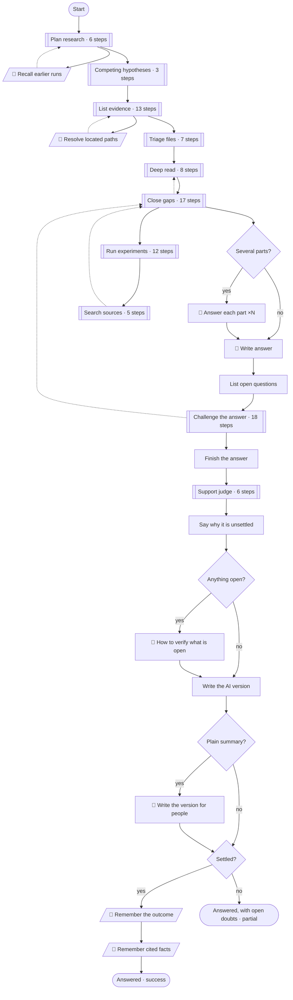
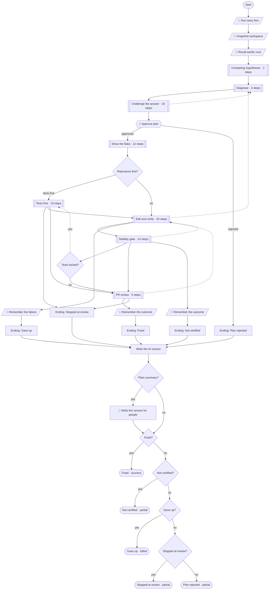
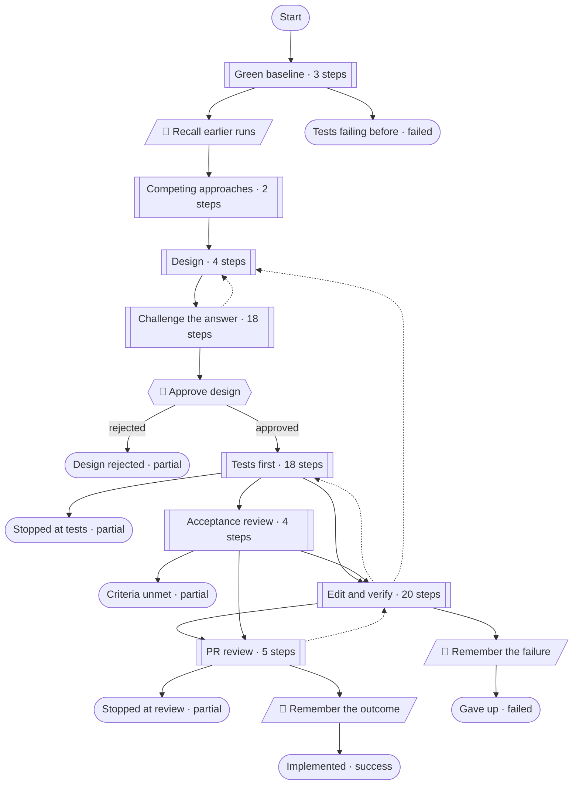

# The algorithm flows

Each pattern is a TypeScript file in [`src/patterns/`](../src/patterns). The diagrams below
are generated from those files by `npm run docs` (a test fails when they are out of date),
with each phase drawn as one box; the table under a diagram lists the steps inside each
phase. In the studio, click ⊕ on a phase to open it.

Legend: 🤖 an AI step (*edits* = an executor that may change files; ×N = split into parallel
sub-agents) · 🔧 a tool the engine runs · 👤 your approval · ◇ a condition the engine
evaluates · plain boxes are engine computations · dashed arrows go back (loops, all bounded).

Shared building blocks (in [`src/patterns/phases/`](../src/patterns/phases)):

| Phase | Used by | What it guarantees |
|---|---|---|
| Competing hypotheses | investigate, fix, implement | At least 3 rival explanations (2 for a routine problem), one of them "none of these" or "the premise is wrong", before any evidence is read. |
| Evidence and citations | investigate, fix, implement, review | Every finding cites `path:line` with a quote, or a URL / named source. The engine checks file citations; failures go to `unverified`, not into the answer. |
| Gap research (chase) | investigate, review | A research step whose every fact is cited and checked, then merged; the pattern judges again with what it found, bounded. investigate chases its gaps and the objections sent back; review chases the claims it could not settle and the objections its debate sent back. |
| Challenge (debate) | investigate, fix, implement, review (findings-shaped) | By complexity: a skeptic (≥2; read-only tools and another model family; at most 5 objections, each naming the finding or quoted claim it attacks; an objection repeated word for word from an earlier round is reported as unresolved instead of researched again, while a reworded one is treated as new), a pragmatist (from complexity `pragmatistFrom`, 3) who triages each one as REAL or THEORETICAL with a cited reason, a second independent investigator (4). REAL objections go back to research, bounded by `maxDebateRounds`; the next answer must resolve, rebut or mark OPEN each one by its tag; those still open are reported. |
| Edit and verify | fix, refactor, implement | An executor edits; the engine captures the diff (an edit that changed nothing is caught), runs the tests and the linter, and triages failures: environment, wrong diagnosis (back to research), or try again, bounded by `maxAttempts`. |
| PR review | fix, refactor, implement | A reviewer reads the diff, with review's categories and Clean Code ids; each comment cites its line with a quote, and each BLOCKING one names what it bears on (the goal, what it is checked against, tests or Clean Code). Blocking comments go back to editing, bounded; you can accept despite the review. |

**Code standard.** Every step that writes or reviews code is held to the practices of *Clean
Code* (Robert C. Martin), summarized in our own words in
[`src/core/standards.ts`](../src/core/standards.ts), one rule per chapter: names, functions,
duplication, errors, comments, formatting, objects and data, boundaries, classes, systems, simple
design, concurrency, tests (F.I.R.S.T.), and the code you touch left a little cleaner. The
codebase's own conventions come first. Reviewers also get the 66 smells and heuristics of ch. 17
by id (C1 to T9) and the F.I.R.S.T. test qualities, and name one in each CLEAN finding.
- Executors with workspace tools always get it in their prompt.
- Steps marked `reviewsCode` (review's *Find issues*, the PR review phase) judge against it:
  - review reports a break as a `CLEAN` finding;
  - the PR reviewer makes a clear break in the new code BLOCKING.

The 🧹 badge on a node in the studio shows which steps are held to it.

---

## investigate

Answer a question with evidence, from whatever sources it needs: workspace files, web pages,
experiments, git history, GitHub, dependencies, Azure DevOps (read-only `az`), MCP servers.
Read-only `az` commands (`list`, `show`, `get`, `query`; `az rest` and `az devops invoke` only as
GET) and a `kusto_query` tool (queries and `.show` only, signed in with `az login`) let research
read pipelines, branch policies and Kusto tables; nothing that writes is allowed.

1. **Recall and plan.** Facts and lessons from earlier runs are recalled and re-checked
   against today's files, once for the question and again for the sub-questions (within the
   same caps: 12 facts, 6 lessons). The planner splits the question into sub-questions, decides for
   every available source whether it can hold evidence (a reason for each skip), chooses
   how many sub-agents to use (1-6), and may split the question into independent parts. The
   web and experiments are always used when they are on offer: a plan that skips either is
   sent back.
2. **Hypotheses.** Competing answers before any evidence, each with what would confirm or
   refute it. The engine keeps a tally per hypothesis (`hypothesisStatus`: findings for and
   against, *untested*, *challenged*) after every batch, and later steps steer by it.
   `readerHypotheses: false` (an ablation switch, on by default) keeps the hypotheses from the
   evidence readers, who then may not tag findings; assess, the answer and the debate keep them.
3. **List evidence.** Only what the plan needs. The engine ranks the files by the words they
   share with the question, sub-questions and search terms (`repo.rank`: git grep hits and
   path names, never the AI's hypotheses), so the likeliest are triaged first; it is an order,
   every file is still read. A large repository is searched first (locate, given the engine's
   top matches as a lead and unioned with them) instead of triaging every file, unless
   `exhaustive` is set; every file it did not locate is named in the coverage
   (`unlocatedFiles`). `narrowRead` (opt-in) applies where every file would be triaged (at most
   `maxTriageFiles`, or `exhaustive`): it triages only the files the search matched plus
   `narrowBudget` (20) more, and names every file it leaves unread (`narrowedOut`). A larger
   repository is already narrowed by Locate; to narrow it further, lower `maxTriageFiles`.
4. **Triage → deep read.** Files are read whole by the engine (`preload`) and given to
   sub-agents in parallel batches; an answer that skips a file of its batch is rejected. A
   file the engine could not read is named in the prompt so the step reads it with tools.
   Every relevant file and page is then read completely, and "completely" is the engine's
   call, not the AI's. Each item is checked against the engine's record of what it gave, and
   the check fails closed: no record, or a failed load, counts as not read. A file cut short
   (too long for one prompt, or cut by the call's size budget) gets its remaining lines as a
   chunk (`path#chunk=from-to`), read next, first in the queue, until the file is done; a
   file triage was not given whole goes to the deep read. The reader writes one note per item
   (`readNotes`, checked against the batch). Unreadable items, and one nothing of fit, are
   retried once at the end, one per call, except PDFs and binaries, which would fail the same
   way.
   `singlePass: true` (on with `lean`, below): triage also reads the relevant files in
   depth (following references and history) and writes a checked note per file, and those it
   read completely skip the deep read only if the engine's preload record shows it gave them
   whole (no record: none skip).
5. **Experiments** (after your approval) and **source searches**, in parallel. Each
   experiment is targeted: it runs only the tests or commands that bear on a hypothesis, never
   the whole suite (a design that would is sent back). Each runs in a throwaway copy of the
   workspace (a git worktree) that is discarded after the call; with no copy to be had it runs
   in the workspace and says so.
6. **Close gaps.** The gap check writes one entry per sub-question, in order: `S<n>:
   ANSWERED [F…]` citing findings, or `S<n>: GAP — what is missing`; the engine derives the
   gaps from it. First the gaps expand the read: the engine ranks the files not yet read by the
   gaps' words (`repo.rank`) and sends up to `expandWave` (8) matches to the deep read, at most
   `maxExpandRounds` (2) times, then checks again. Then targeted research (`gapAimed`, a pilot:
   aimed at what the GAP notes say is missing). It moves on only when no gap is left and
   nothing is queued to read, never on the model's confidence; otherwise it asks you once for
   a hint.
7. **Answer.** Cited by finding id, one answer per sub-question (or OPEN), one ruling per
   hypothesis. The engine appends a coverage section: files not triaged, pages, experiments,
   what could not be read, sources searched and skipped, findings taken on trust.
8. **Challenge.** The debate above; REAL objections reopen research (within the run-wide
   research budget), at most `maxDebateRounds` (3) rounds. After the first, another round plays
   only when the last one's research found new evidence; `debateLog` says why it stopped (the
   skeptic only repeated itself, the cap, or nothing new). `keepUnchallenged: true` (off by default, for an A/B) makes the rewrite
   keep word for word the sub-answers no objection named, so it opens no new front.
9. **Support judge** (`supportJudge`: off by default; `shadow`, `enforce`). Each cited
   workspace finding's quote, with the numbered lines around it, its claim and nothing else, is
   shown to another model family. It rules SUPPORTED when those lines bear the claim out, even in
   other words, and UNSUPPORTED when they contradict it or don't show what it adds. Unsupported findings are never remembered;
   in `enforce` they also make the answer partial. Web and other sources are said to be
   uncheckable, never judged.
10. **Settle.** Settled means no unresolved objection, no OPEN sub-answer or objection
   resolution, and enough confidence. A settled answer ends `success`, remembers the findings
   it cited and a lesson built from its checked sub-answers (only when it names a workspace
   file, so the lesson goes stale with the code). Anything else ends `partial`, with the
   reasons in `doubts`, and teaches nothing.
11. **Two versions of the result, one for each reader.**
    - **For people (`summary`).** It comes first, written by the AI from the cited answer in
      Simplified Technical English (ASD-STE100). It has short sentences, one idea in each,
      common words, the active voice and terms explained, and no citation ids. Its sections are
      *In short*, *What we found*, *What to do* (only when the answer recommends actions), *What
      is not certain* and *How we checked*. The engine sends it back when a sentence has more than
      25 words (naming each one), when it holds a citation id, or when a section is missing. The
      `plainSummary` switch (on by default) turns it off, which saves one model call.
    - **For an AI agent (`handoff`).** The engine writes it from the record, so it is complete
      and the same every time. In order, most important first:
      - the task;
      - the status (settled, or why not) and the confidence;
      - instructions for the next agent;
      - what is still open;
      - every sub-answer and ruling;
      - the cited evidence;
      - the findings not to rely on;
      - the full answer with its coverage.

      A chained run (fix, refactor…) gets this brief with the whole handoff budget (30,000
      characters); the people's version is not handed on.

<!-- flow:investigate -->
<!-- Generated from src/patterns by `npm run docs`: edit the pattern, not this block. -->

| Phase | What it does | Steps |
| --- | --- | --- |
| Plan research | Available sources, sub-questions, which evidence applies | Lean run? → List sources → Plan research → Recall for the sub-questions → Merge recalled leads → Queue sources |
| Competing hypotheses | Every plausible explanation, each with what would confirm or refute it; how hard it is | Propose hypotheses → Set complexity → Cap the rated complexity |
| List evidence | Only what the plan needs: workspace files, likeliest first (a big repo is searched first), web pages, experiments | Hypotheses for the readers → Workspace? → List every file → Rank files → Count files → Triage every file? → Queue files → Locate files → Queue located files → Web? → List web pages → Experiments? → Design experiments |
| Triage files | Every listed file, in batches | Files left? → Next batch → Single pass? (pilot) → Triage files → Triage and read in depth → Check citations → Record triage |
| Deep read | Every relevant file and listed page, completely | Queue deep reads → Deep reads left? → Next deep batch → Deep read → Check citations → Record deep read → Retry unreadable? → Queue unreadable again |
| Run experiments | With your approval, run and measure | Experiments listed? → Allow experiments? → Queue experiments → Untimed experiments? → Run experiments side by side → Check citations → Record experiments → Timed experiments left? → Next experiment → Run timed experiment → Check citations → Record experiment |
| Search sources | History, GitHub, dependencies, MCP | Sources left? → Next source → Search source → Check citations → Record source |
| Close gaps | Targeted research, then a human hint | Find gaps → Record gaps → Expand the read? → Unread files → Rank by the gaps → Queue gap files → Files queued? → Gap expansion read? → Back to the gaps → Chase gaps? → Aim the research → Close gaps → Check citations → Record gap research → Gaps closed? → Ask for a hint → Use hint |
| Challenge the answer | Skeptic, pragmatist and a second investigator, scaled by complexity | Skeptic? (≥2) → Skeptic → Only repeats? → Report the repeats → Set repeats aside → Objections? → Research them? (rounds left, research still finding) → Report open objections → Pragmatist? (≥pragmatistFrom) → Pragmatist → Keep every objection → Real objections? → Research objections → Second investigator? (4) → Second investigator → Check citations → Record its evidence → Reconcile |
| Support judge | Off by default: does each cited finding's quote back its claim? | Support judge? → What the judge can check → Lines around each quote → Any to judge? → Support judge → Record the rulings |

<!-- /flow:investigate -->

**Lean** (`lean`, on by default) bundles the settings estimated to cut time and tokens together:
single-pass triage, gap-aimed research, unchallenged sub-answers kept,
a sub-agent per gap, and an AI-rated complexity 4 (the investigation's or the maestro's) capped
at 3; a complexity you set stays. Turn it off
(studio Features, or `--with lean=false`) if answers get worse; the settings then apply as set.
See [settings.md](settings.md) and the lean trial in [trials.md](trials.md).

**How to verify what is open.** When questions stay open, a step writes one line for each, in
order: `V<n> READ|QUERY|RUN — the exact files, query or command — what it would show`. The
brief has them under "How to verify what is still open".

**Follow-up** (`followOpen`, off by default; a Features switch, since it is one more
investigation): an investigation that leaves questions or objections open puts one more
investigate run in front of the chain. Its question lists each open item with its check, then
the brief; it has experiments on offer like any investigation, and it does not follow itself up.

## fix

Fix a bug: the diagnosis comes from evidence, you approve it, and the engine (not the AI)
decides whether the tests pass.

fix shares investigate's debate and evidence phases (hypotheses, checked citations, the
skeptic), but not its read pipeline: one research step reads the code (optionally split by
hypothesis, `hypothesesPerResearch`), instead of triage and deep reads.

1. **Run the tests first.** What fails before any edit, the bug or tests already broken, is
   known to the diagnosis and the triage. The command that ran is kept: every later test run
   uses it. A detected `npm test` still reads the test script on each run, so an edit to
   package.json is flagged (`checkFiles`) for the reviewer.
2. **Recall, hypotheses, evidence.** Research and the debate read the findings brief; the
   diagnosis reads the findings in full.
3. **Diagnose** a root cause from the cited evidence; the challenge phase attacks it. Research
   and the diagnosis are given the usual causes of intermittent failures. An intermittent
   failure must name its test as its result line shows it (`flakyTarget`), the test's file, and
   where the fix goes (`fixTarget`: CODE, TEST or ENVIRONMENT).
4. **👤 Approve the plan** (root cause, files, the change, the test).
5. **Show the flake** (with the stability gate, below): before any edit, the gate command must
   make the flaky test fail.
6. **Reproduce first** (`reproduceFirst`, opt-in): a test that reproduces the bug is written,
   proved to fail for the right reason and locked; the fix must leave it unchanged.
7. **Edit and verify.**
   - **Progress.** An edit that changes nothing, returns to the starting workspace, or
     repeats any earlier attempt is not progress.
   - **Lint.** Lint runs only once the tests pass.
   - **Wrong diagnosis.** A failure triaged as a wrong diagnosis goes back to research for a
     new diagnosis (bounded).
   - **Environment problem.** The same patch is tested once more; if it still fails, the run
     gives up with that reason. A failure of the flaky test itself is never an environment
     problem: the patch did not make it stable.
   - **No hiding.** The edit may not hide a failure (retries, skips, longer timeouts, wider
     slack, fewer workers) unless the plan shows the old limit was wrong for measured work.
   - **Budget.** `maxEdits` (8) bounds the tested edits across diagnoses and review rounds.
8. **Stability gate** (opt-in, below), then **PR review**.
   - **Agreement.** The decision must agree with the comments: APPROVE has no BLOCKING
     comment, REQUEST_CHANGES has one. Earlier comments now addressed are RESOLVED.
   - **Weakened checks.** Changed files that configure the checks (`checkFiles`) are flagged,
     so weakening the checks is blocking.
   - **Nothing changed.** If no review edit changes the patch the reviewer saw, which passed
     the checks, a person decides on that exact patch.
   - **Remember.** The outcome is remembered: fixed, or why it failed.

Only the tests the command runs are checked. In this repository the root `npm test` does not
run `packages/ui`, so set `testCommand` for a fix there.

### Flaky tests: the stability gate

One green run, or a red run then a green re-run, cannot tell a repaired flaky test from a lucky
one. The gate is off by default (`maxStabilityRuns` and `autoStabilityRuns` are 0), and a run
without it gains only three steps with no I/O. Arm it with `maxStabilityRuns` (always), or with
`autoStabilityRuns` (only when the diagnosis finds the failure intermittent, or when a failure
passes on a re-run).

- **The command.** `stabilityCommand` must make the flaky test fail (under load, shuffled with
  a logged seed, or the whole suite) and print each test's result. For vitest add
  `--reporter=verbose`: under CI its default reporter prints no passing test. Empty: the test
  command.
- **Control.** Before any edit, the command runs fresh until the flaky test's own failure line
  shows (`maxControlRuns`, 20). If it never fails, a person decides; unattended, the run stops
  at "Flake not shown". Editing anyway, or a gate armed after an edit (a re-diagnosis, or a
  re-run that passed), has no control, so the patch is never certified.
- **Runs.** After verify, the command runs fresh until the flaky test has passed `maxStableRuns`
  times. That is at least `runsNeeded(stabilityTolerance, maxEdits)`: 49 runs for a tolerance of
  0.1 across 8 patches, 29 for one. A failure, or a pass only on a retry, sends the patch back
  through the edit loop's budgets. Runs that show neither (another test failed, a timeout,
  output cut) do not count. If more than a quarter of the runs are like that, the patch is not
  certified.
- **Masking flags.** These go to a person; unattended, the patch is not certified:
  - the flaky test's own file changed (a retry or a sleep added there looks like a new test);
  - other tests' lines were changed or removed, or added ones skip, invert, retry or lengthen a
    test;
  - added code touches retries, timeouts, slack, workers or sleeps;
  - assertions were removed;
  - files that configure the tests changed;
  - the diff cannot show a file (binary, or cut);
  - more tests are skipped, todo or expected-fail than in the control.

  For an intermittent failure the edit is asked to put its regression test in a new test file,
  which is not flagged. New files are shown in the diff as additions.

  These checks are heuristics. A loosened limit and a real fix of that limit look alike (raising
  `TIME_SLACK` and adding a time floor both touch the same line), so the person decides. A
  certified patch still goes through the review, which reads the report and the flags.
- **Certified** means: under that command, the flaky test's failure rate is below
  `stabilityTolerance` at 95% across `maxEdits` patches. It does not mean "never flaky". The
  report (`stabilityReport`) says so. Anything less ends at "Not certified" (partial): the patch
  is kept as a file, never applied, and the lesson is remembered with open doubts.
- **Cost.** About three steps per run (about 150 per patch by default); `maxSteps` (1000) fits
  the control and five or so measured patches. A run that reaches the limit ends partial, never
  Fixed.
- **One way.** Once armed, a re-diagnosis that no longer calls the failure intermittent does not
  disarm the gate.
- **The test's name.** `flakyTarget` is the text on the line where the runner reports the test's
  result: `src/a.test.ts > suite > test` for vitest, the test's name for node and jest. If it is
  wrong, the control never sees it fail, and the run stops at "Flake not shown".

**Two versions of the result.** As in investigate (step 11), the result starts with a short version
for people in Simplified Technical English (`summary`, checked by the engine; the `plainSummary`
switch turns it off), then a brief for an AI agent written by the engine from the record
(`handoff`): the status (fixed, not certified, gave up, stopped at review or plan rejected), instructions for that status, the root cause, the plan, the changed files, the review, open objections, the stability report, rulings and evidence. The run marks which end it reached, writes both, then ends there; a chained
run gets the brief whole.

<!-- flow:fix -->
<!-- Generated from src/patterns by `npm run docs`: edit the pattern, not this block. -->

| Phase | What it does | Steps |
| --- | --- | --- |
| Competing hypotheses | Every plausible explanation, each with what would confirm or refute it; how hard it is | Propose hypotheses → Set complexity |
| Diagnose | Evidence for and against every hypothesis, then the root cause | Gather evidence → Check citations → Record evidence → Diagnose |
| Challenge the answer | Skeptic, pragmatist and a second investigator, scaled by complexity | Skeptic? (≥2) → Skeptic → Only repeats? → Report the repeats → Set repeats aside → Objections? → Research them? (rounds left, research still finding) → Report open objections → Pragmatist? (≥pragmatistFrom) → Pragmatist → Keep every objection → Real objections? → Research objections → Second investigator? (4) → Second investigator → Check citations → Record its evidence → Reconcile |
| Show the flake | With the stability gate: before the edit, the flaky test must fail under the gate command | Arm the stability gate? → Show the flake first? → Workspace unpatched? → No edit yet? → No control possible → Start the control → Run before the edit → Count control run → Run the control again? → Flake shown? → Edit without the flake shown? → Flake not shown |
| Tests first | Tests written before the code must fail for the right reason, then stay locked | Plan the reproducing test → Write tests first → Capture tests → Only tests changed? → Not accepted → Run tests (must fail) → Red? → Not accepted → Failing for the right reason? → Right reason? → Not accepted → Try again? → Write them again → Implement anyway? → Lock tests → Tests are the base → Tests untouched? → Same tests? → Tests were changed |
| Edit and verify | Edit; the engine diffs and runs the tests; failures are triaged | Edit → Capture diff → Anything new? → No progress → Run tests → Lint? → No lint run → Run lint → Count attempt → Tests pass? → Attempts left? → Triage failure → Environment? → Run the tests again? → Run again → The reviewed patch? → Back to the reviewed patch → Diagnosis wrong? → Diagnose again? → Back to diagnosis |
| Stability gate | With the gate: the patch passes the flaky test in fresh runs, with no masking edits, or is not certified | Stability gate? → Start the gate → Run again (gate) → Count gate run → Run the gate again? → Flaky test failed? → Not stable → Masking flags → Certified? → Masking flags? → Fixed, or hidden? → Certify → Reviewed patch certified? → Not certified |
| PR review | Review the change; blocking comments go back to editing until approved | PR review → Approved? → Review again? → Back to editing → Accept despite review? |

<!-- /flow:fix -->

## refactor

Restructure code without changing behaviour. The tests are the oracle: they must pass
before anything changes and after.

1. **Green baseline.** The engine runs the tests first; a red baseline stops the run (a
   refactor cannot prove it preserved behaviour that was already broken).
2. **Plan** the files, steps and the invariants that must not change; **👤 approve** it.
3. **Edit and verify** against the invariants. Bugs noticed on the way are reported
   (`noticedBugs`), not fixed.
4. **PR review.**

<!-- flow:refactor -->
<!-- Generated from src/patterns by `npm run docs`: edit the pattern, not this block. -->

| Phase | What it does | Steps |
| --- | --- | --- |
| Green baseline | Tests must pass before anything changes | Run tests first → Green? → Snapshot workspace |
| Plan | Files, steps and the behaviour that must not change | Plan refactoring → Approve plan |
| Edit and verify | Edit; the engine diffs and runs the tests; failures are triaged | Edit → Capture diff → Anything new? → No progress → Run tests → Lint? → No lint run → Run lint → Count attempt → Tests pass? → Attempts left? → Triage failure → Environment? → Run the tests again? → Run again → The reviewed patch? → Back to the reviewed patch |
| PR review | Review the change; blocking comments go back to editing until approved | PR review → Approved? → Review again? → Back to editing → Accept despite review? |

<!-- /flow:refactor -->

## implement

Build a feature. Passing tests are not enough: every acceptance criterion must be met, with
evidence.

1. **Baseline** tests, then **competing approaches** (the hypotheses phase) and evidence
   from the code.
2. **Design** with acceptance criteria; the challenge phase attacks it; **👤 approve** it.
3. **Tests first.** Tests written before the code must fail, for the right reason; then they
   are locked, and the engine checks that edits leave them untouched.
4. **Edit and verify** against the locked tests.
5. **PR review**, then an **acceptance review**: each criterion met, with evidence, or the
   edit goes back (bounded).

<!-- flow:implement -->
<!-- Generated from src/patterns by `npm run docs`: edit the pattern, not this block. -->

| Phase | What it does | Steps |
| --- | --- | --- |
| Green baseline | Tests must pass before anything changes, or a failure could not be told apart | Run tests first → Green? → Snapshot workspace |
| Competing approaches | Every plausible explanation, each with what would confirm or refute it; how hard it is | Propose hypotheses → Set complexity |
| Design | Evidence for and against each approach, then a design with acceptance criteria | Explore the code → Check citations → Record evidence → Design |
| Challenge the answer | Skeptic, pragmatist and a second investigator, scaled by complexity | Skeptic? (≥2) → Skeptic → Only repeats? → Report the repeats → Set repeats aside → Objections? → Research them? (rounds left, research still finding) → Report open objections → Pragmatist? (≥pragmatistFrom) → Pragmatist → Keep every objection → Real objections? → Research objections → Second investigator? (4) → Second investigator → Check citations → Record its evidence → Reconcile |
| Tests first | Tests written before the code must fail for the right reason, then stay locked | Write tests first → Capture tests → Only tests changed? → Not accepted → Run tests (must fail) → Red? → Not accepted → Failing for the right reason? → Right reason? → Not accepted → Try again? → Write them again → Implement anyway? → Lock tests → Tests are the base → Tests untouched? → Same tests? → Tests were changed |
| Edit and verify | Edit; the engine diffs and runs the tests; failures are triaged | Edit → Capture diff → Anything new? → No progress → Run tests → Lint? → No lint run → Run lint → Count attempt → Tests pass? → Attempts left? → Triage failure → Environment? → Run the tests again? → Run again → The reviewed patch? → Back to the reviewed patch → Diagnosis wrong? → Diagnose again? → Back to diagnosis |
| PR review | Review the change; blocking comments go back to editing until approved | PR review → Approved? → Review again? → Back to editing → Accept despite review? |
| Acceptance review | Every criterion met, with evidence; unmet ones go back to editing | Acceptance review → All met? → Review again? → Back to editing |

<!-- /flow:implement -->

## backlog

Turn a document of improvements (a file, pasted text, or what investigate found) into
separate requests, and play each one as its own run.

1. **Extract items**: self-contained requests, at most 10.
2. **👤 Pick items** by number (or all). Invalid numbers are asked again.
3. **Queue.** Each pick becomes its own run of `runPattern` (implement by default, or fix or
   refactor), with its own worktree, approvals and PR review. A failed item does not stop
   the rest.

<!-- flow:backlog -->
<!-- Generated from src/patterns by `npm run docs`: edit the pattern, not this block. -->

<!-- /flow:backlog -->

## review

Review a branch or PR. Only real issues are reported, each cited and checked.

0. **Check out the PR.** When `target` is a pull request link (Azure DevOps
   `…/pullrequest/N` or GitHub `…/pull/N`) or "PR N", the runtime fetches `refs/pull/N/merge`
   with your own git credentials. Both hosts publish that ref. It checks the commit out in a
   temporary worktree outside your repository, and the review plays there, on the PR's own code,
   whatever branch your workspace is on. The worktree is removed when the run ends, and your
   workspace, branches and refs are left as they were. The `git.pr` step gives the PR's base and
   changed files. A PR that cannot be fetched ends `failed` before any AI step, with why ("Could
   not review: could not fetch refs/pull/N/merge … (Authentication failed)"). Only real AI runs
   check out; scripted demos play on the workspace as it is.
1. **Collect the diff** (never replayed: a PR can change on its host): the files to review, the
   files the change deletes, the files left out and why (lockfiles, generated, binary), the git
   range of the change, and what the change claims to do. With a PR checked out, the diff is
   `git diff <prBase> HEAD`. Every changed file must be listed, deleted or left out with why, and a
   path the PR does not change is sent back by name. No changes ends `failed` with why in the
   report ("Could not review: …"), never an empty report and never "looks good". A change that
   only deletes files is still reviewed: what still uses them is judged.
2. **Cap and scan.** At most `maxFiles` (60) files are reviewed; the rest are named as not
   reviewed. The engine scans the diff (`diff.scan`, no AI): smells in the added lines (long
   blocks, more than three parameters, boolean parameters, commented-out code, debug output, each
   with its Clean Code id) and test changes that may hide a failure (a test skipped or focused,
   assertions removed, a retry or wait added, a test file deleted). These are leads for the
   reviewers, never findings by themselves.
3. **No tests or lint.** A review never runs them: the change's CI pipeline does. The brief says
   so. Changed tests are still read, and judged like any code.
4. **Gather context**, once, over the whole change, before anyone judges it:
   - `claimList`: what `claims` says and `intent` (an optional input: the linked issue or its
     acceptance criteria) asks for, one claim each (`C1 …`);
   - `context`: for each changed file, the conventions, similar code and callers to compare it
     with, citing that rule or code and naming the file it is for
     (`AGENTS.md:3 — [CONVENTION] (for: db/schema.sql) why \`quote\``);
   - `behaviours`: what the change adds or changes (`B1 path:line — …`);
   - `obligations`: the other changes it requires (`O1 [CALLER|MIGRATION|CONFIG|DOCS|ERRPATH]
     path:line — what must exist`), cited at the line that creates the need.

   Each list is numbered in order (checked) and its citations are checked while the AI still has
   the files open (`cites` and `citesAlso`), then again by the engine. An entry whose citation
   still fails is kept apart, and it keeps the review from ending "Looks good". Obligations are
   only what the codebase requires: a rule, what similar changes include, or code that breaks.
5. **Find issues** in parallel parts. Each issue is
   `path:line — [CATEGORY] [HIGH|MEDIUM|LOW] problem \`quote\``, checked by the engine. The
   categories (shared with the PR review phase, in `phases/reviewRules.ts`):
   - BUG, SECURITY, PERF;
   - CONCURRENCY, ERRPATH (null, undefined, empty and error results), COMPAT (exported
     signatures, config keys, schemas, wire formats);
   - TEST, FLAKY;
   - MISSING (a change the diff needs but does not contain, cited at the line that needs it);
   - REDUNDANT;
   - DESIGN (names the similar code it was compared with);
   - CLEAN (with a Clean Code rule id, e.g. `[CLEAN] [MEDIUM] [G5]`, checked against the list);
   - CLAIM, SCOPE (an edit unrelated to what the change is for).

   Each part also attests, per dimension, what it examined (`D5 PITFALLS: NONE — …`), so "did
   not look at concurrency" and "concurrency is fine" read differently. Eight dimensions, in
   order, each checked: correctness, fit, sense, Clean Code, pitfalls, missing code, tests and
   smells. An attestation that says ISSUES needs a finding. An honest "could not read it" ends
   `failed`.
6. **Judge the whole change**, once, on a stronger tier, with the whole diff:
   - a verdict per claim (`C1 MET|PARTIAL|NOT MET|UNCLEAR`);
   - the approach, against the similar code: one alternative, and what could regress;
   - a verdict per behaviour on its tests (`B1 TESTED|WEAK|UNTESTED|NA`);
   - a verdict per required change (`O1 FOUND|ABSENT`);
   - each file related or unrelated to what the change is for.

   One verdict per entry, by id and in order: an omitted or doubled entry is sent back. Each
   adverse verdict (PARTIAL, NOT MET, WEAK, UNTESTED, ABSENT, unrelated) must also be a finding,
   which is checked and merged like the others.
7. **Settle open points** (investigate's gap research, shared): a claim the whole-change step
   marked UNCLEAR is researched (`maxChaseRounds`, 1), every fact cited and checked into
   `evidence`, and the whole change is judged again with it.
8. **Challenge the review** (investigate's debate, shaped for findings):
   - a **second reviewer** (complexity 4, once; another model family) reviews the whole change from
     scratch; what it finds is checked and merged, a repeat of a finding left out;
   - the **skeptic** (from complexity 2, even with no finding: a missed issue is the costliest
     mistake) proposes one disposition per finding (`KEEP`, `DOWNGRADE MEDIUM|LOW`, `DROP` with
     the code that refutes it, or `DROP — duplicates F<m>`) and at most 5 objections, each naming a
     verdict (C2, B1, O3) or a missed issue's `path:line`;
   - the **pragmatist** (from `pragmatistFrom`, 2 in review; only when the skeptic would drop,
     downgrade or object) keeps a drop or downgrade it finds theoretical, and triages each
     objection REAL or THEORETICAL; it can never drop on its own (checked). Seen live: an unchecked
     skeptic dropped the one real finding of a review.

   The engine applies the dispositions: dropped findings are kept apart under "Dismissed",
   downgrades change the severity. REAL objections go back to research and the whole change is
   judged again, bounded by `maxDebateRounds` (3), and after the first round only when research
   found new evidence; one raised again word for word is reported as not settled instead of
   researched again.
9. **Memory.** What earlier runs found true and that still matches the files (`knownFacts`) is
   recalled at the start; every judging step reads it as leads to check, never as evidence.
10. **Review comments** (when there are issues): one per finding, in order, in parts of three,
   each checked to have every part, so that someone new to the code can understand it and act on
   it:
   - **What is wrong**, in plain words, at path:line;
   - **Example**: for a pattern, regex, parser, boundary or logic bug, 2 or 3 inputs with what
     the code gives today and what it should give; for a missing test, the test as code; for a
     design, Clean Code or naming issue, the current code and the suggested code;
   - **Why it matters**: who or what breaks, when, and how badly;
   - **How to fix**: the smallest correct change (a snippet when it is short) and the test that
     would catch it.

   Examples are worked out from the code, not run: a review step has no interpreter and no
   browser, so it shows no screenshots.
11. **Report**: a short summary citing the findings by id (the comments hold the detail), what is
   not settled, and what was not reviewed or not checked. It ends:
   - **Issues reported** (success), or **Issues reported, not all settled** (partial) when
     something is open: an UNCLEAR claim, a context citation that failed, a step that failed (the
     skeptic or the whole-change step), or an objection the debate could not settle;
   - with nothing found: **Could not verify** (partial) when findings' quotes are missing from this
     checkout; **Reviewed in part** (partial) when files were over the cap or not read whole;
     **Not settled** (partial) when something is open, or the skeptic dropped every finding;
     **Looks good** (success) only otherwise. An objection the debate could not settle counts
     as something open.

**Hand-off to investigate** (`investigateOpen`, off by default; a Features switch, since an
investigation costs more than the review): a review that ends with something not settled
(**Not settled**, or **Issues reported, not all settled**) puts an investigate run in front of
the chain. Its question lists the open points, then the review's brief. For a pull request, the
hint says to read its change first: the investigation plays in your workspace, not in the PR's
checkout.

Known limits:
- Citations to URLs or PR numbers are not checked.
- Files are given to the model whole by the engine, so a file your organisation's Copilot content
  exclusion covers is not held back here: review such repositories with that in mind.
- The claim list is written by the context step: a claim it leaves out gets no verdict. The
  whole-change step cannot leave one out.
- The Clean Code rules and the 66 rule ids of ch. 17 are checked against the book; their glosses
  are our own words.

**Measuring it.** `npm run cli -- eval --task review-…` runs the seeded review tasks. Each plants
one defect: a fix in the wrong place, an untested behaviour, a loosened assertion, a copied helper
with a flag argument, a caller not updated, a missing migration (plus a control with it present),
an unchecked lookup, a broken AGENTS.md rule, and an unrelated edit. The report gives recall per
category and the false flags (`review-clean` is the false-flag control).

**Two versions of the result.** As in investigate (step 11), the result starts with a short version
for people in Simplified Technical English (`summary`, checked by the engine; the `plainSummary`
switch turns it off), then a brief for an AI agent written by the engine from the record
(`handoff`): the status, instructions (fix HIGH first, re-read each line, run the tests), the checked findings, what is not settled, what the skeptic dismissed, what not to rely on, what the change says it does, the verdicts per claim, behaviour and required change, the engine's scan, what each reviewer examined, the review comments in full, the coverage, and the review as written. The run marks which end it reached, writes both, then ends there; a chained
run gets the brief whole. The people's version starts each finding with its location
(`` `src/app.ts:42` — … ``), so you can find the line. The engine sends the summary back when a
finding's location is missing.

```mermaid
flowchart TD
  n_start(["Start"])
  n_prInfo[/"🔧 Pull request"/]
  n_prFetched{"PR fetched?"}
  n_noPr["Say why"]
  n_collect["🤖 Collect diff"]
  n_hasDiff{"Anything changed?"}
  n_capFiles["Files to review"]
  n_recall[/"🔧 Recall earlier runs"/]
  n_scanDiff[/"🔧 Scan the diff"/]
  n_gatherContext["🤖 Gather context"]
  n_contextOk{"Context gathered?"}
  n_noteContextFailed["Note it"]
  n_checkContext[/"🔧 Check context"/]
  n_checkBehaviours[/"🔧 Check behaviours"/]
  n_checkObligations[/"🔧 Check obligations"/]
  n_mergeContext["Keep what failed"]
  n_hasFiles{"Files to read?"}
  n_analyze["🤖 Find issues ×N"]
  n_analyzed{"Reviewed?"}
  n_checkReview[/"🔧 Check citations"/]
  n_mergeReview["Record issues"]
  n_wholeChange["🤖 Judge the whole change"]
  n_wholeOk{"Judged?"}
  n_noteWholeFailed["Note it"]
  n_checkWhole[/"🔧 Check citations"/]
  n_mergeWhole["Record its issues"]
  n_summarize["What is settled"]
  n_hasIssues{"Issues?"}
  n_comment["🤖 Write review comments ×N"]
  n_report["🤖 Write report"]
  n_issuesSettled{"All settled?"}
  n_anyUnverified{"Findings unverified?"}
  n_unverifiedReport["Not verified"]
  n_anyGaps{"Reviewed in part?"}
  n_partReport["Reviewed in part"]
  n_anyOpen{"Anything not settled?"}
  n_openReport["Not settled"]
  n_cleanReport["Nothing found"]
  n_issues(["Issues reported · success"])
  n_issuesOpen(["Issues reported, not all settled · partial"])
  n_clean(["Looks good · success"])
  n_notVerified(["Could not verify · partial"])
  n_partlyReviewed(["Reviewed in part · partial"])
  n_openQuestions(["Not settled · partial"])
  n_noDiffReport["Say why"]
  n_noDiff(["No changes found · failed"])
  n_notReviewed(["Could not review · failed"])
  n_mark_issues["Ending: Issues reported"]
  n_mark_issuesOpen["Ending: Issues reported, not all settled"]
  n_mark_notVerified["Ending: Could not verify"]
  n_mark_partlyReviewed["Ending: Reviewed in part"]
  n_mark_openQuestions["Ending: Not settled"]
  n_mark_clean["Ending: Looks good"]
  n_handoffDoc["Write the AI version"]
  n_wantPlain{"Plain summary?"}
  n_explain["🤖 Write the version for people"]
  n_endIs_issues{"Issues reported?"}
  n_endIs_issuesOpen{"Issues reported, not all settled?"}
  n_endIs_notVerified{"Could not verify?"}
  n_endIs_partlyReviewed{"Reviewed in part?"}
  n_endIs_openQuestions{"Not settled?"}
  n_chasePhase[["Settle open points · 5 steps"]]
  n_debatePhase[["Challenge the review · 16 steps"]]
  n_start --> n_prInfo
  n_prInfo --> n_prFetched
  n_prFetched -->|"yes"| n_collect
  n_prFetched -->|"no"| n_noPr
  n_noPr --> n_notReviewed
  n_collect --> n_hasDiff
  n_hasDiff -->|"yes"| n_capFiles
  n_hasDiff -->|"no"| n_noDiffReport
  n_noDiffReport --> n_noDiff
  n_capFiles --> n_recall
  n_recall --> n_scanDiff
  n_scanDiff --> n_gatherContext
  n_gatherContext --> n_contextOk
  n_contextOk -->|"yes"| n_checkContext
  n_contextOk -->|"no"| n_noteContextFailed
  n_noteContextFailed --> n_hasFiles
  n_checkContext --> n_checkBehaviours
  n_checkBehaviours --> n_checkObligations
  n_checkObligations --> n_mergeContext
  n_mergeContext --> n_hasFiles
  n_hasFiles -->|"yes"| n_analyze
  n_hasFiles -->|"no"| n_wholeChange
  n_analyze --> n_analyzed
  n_analyzed -->|"yes"| n_checkReview
  n_analyzed -->|"no"| n_notReviewed
  n_checkReview --> n_mergeReview
  n_mergeReview --> n_wholeChange
  n_wholeChange --> n_wholeOk
  n_wholeOk -->|"yes"| n_checkWhole
  n_wholeOk -->|"no"| n_noteWholeFailed
  n_noteWholeFailed --> n_debatePhase
  n_checkWhole --> n_mergeWhole
  n_mergeWhole --> n_chasePhase
  n_chasePhase --> n_debatePhase
  n_chasePhase -.-> n_wholeChange
  n_debatePhase --> n_summarize
  n_debatePhase -.-> n_chasePhase
  n_summarize --> n_hasIssues
  n_hasIssues -->|"yes"| n_comment
  n_comment --> n_report
  n_hasIssues -->|"no"| n_anyUnverified
  n_report --> n_issuesSettled
  n_issuesSettled -->|"yes"| n_mark_issues
  n_issuesSettled -->|"no"| n_mark_issuesOpen
  n_anyUnverified -->|"yes"| n_unverifiedReport
  n_anyUnverified -->|"no"| n_anyGaps
  n_unverifiedReport --> n_mark_notVerified
  n_anyGaps -->|"yes"| n_partReport
  n_anyGaps -->|"no"| n_anyOpen
  n_partReport --> n_mark_partlyReviewed
  n_anyOpen -->|"yes"| n_openReport
  n_anyOpen -->|"no"| n_cleanReport
  n_openReport --> n_mark_openQuestions
  n_cleanReport --> n_mark_clean
  n_mark_issues --> n_handoffDoc
  n_mark_issuesOpen --> n_handoffDoc
  n_mark_notVerified --> n_handoffDoc
  n_mark_partlyReviewed --> n_handoffDoc
  n_mark_openQuestions --> n_handoffDoc
  n_mark_clean --> n_handoffDoc
  n_handoffDoc --> n_wantPlain
  n_wantPlain -->|"yes"| n_explain
  n_wantPlain -->|"no"| n_endIs_issues
  n_explain --> n_endIs_issues
  n_endIs_issues -->|"yes"| n_issues
  n_endIs_issues -->|"no"| n_endIs_issuesOpen
  n_endIs_issuesOpen -->|"yes"| n_issuesOpen
  n_endIs_issuesOpen -->|"no"| n_endIs_notVerified
  n_endIs_notVerified -->|"yes"| n_notVerified
  n_endIs_notVerified -->|"no"| n_endIs_partlyReviewed
  n_endIs_partlyReviewed -->|"yes"| n_partlyReviewed
  n_endIs_partlyReviewed -->|"no"| n_endIs_openQuestions
  n_endIs_openQuestions -->|"yes"| n_openQuestions
  n_endIs_openQuestions -->|"no"| n_clean
```

<!-- flow:review -->
<!-- Generated from src/patterns by `npm run docs`: edit the pattern, not this block. -->

| Phase | What it does | Steps |
| --- | --- | --- |
| Settle open points | investigate's gap research: unclear claims and objections, then judged again | What to settle → Research them? → Settle open points → Check citations → Record what was found |
| Challenge the review | A second reviewer (4), the skeptic (≥2) and the pragmatist (≥pragmatistFrom), as in investigate | Second reviewer? (4) → Second reviewer → Check citations → Record its issues → Challenge? (≥2) → Skeptic → Challenged? → Note it → Pragmatist? (≥pragmatistFrom) → Pragmatist → Take the challenge → Apply the challenge → Real objections? → Research them? (rounds left, last one found something) → Research objections → Report open objections |

<!-- /flow:review -->

## analyze

Explore a dataset to answer a question. Every analysis runs as code (scratch scripts), so
the numbers are reproducible even when the route was improvised.

1. **Profile** the data.
2. **Decide the next move** (a solo point). In classical and cool, the written melody plays:
   `maxAnalyses` analyses, then conclude. From swing up, the AI decides after each analysis
   whether to dig further or conclude; in bebop and free it also plays several takes that a
   bandleader merges.
3. **Run the analysis** as code and record it, until the budget is spent.
4. **Conclude** with caveats, citing the analyses.

<!-- flow:analyze -->
<!-- Generated from src/patterns by `npm run docs`: edit the pattern, not this block. -->

<!-- /flow:analyze -->

See also: [how the studio works](./studio.md) and [the maestro](./maestro.md).
