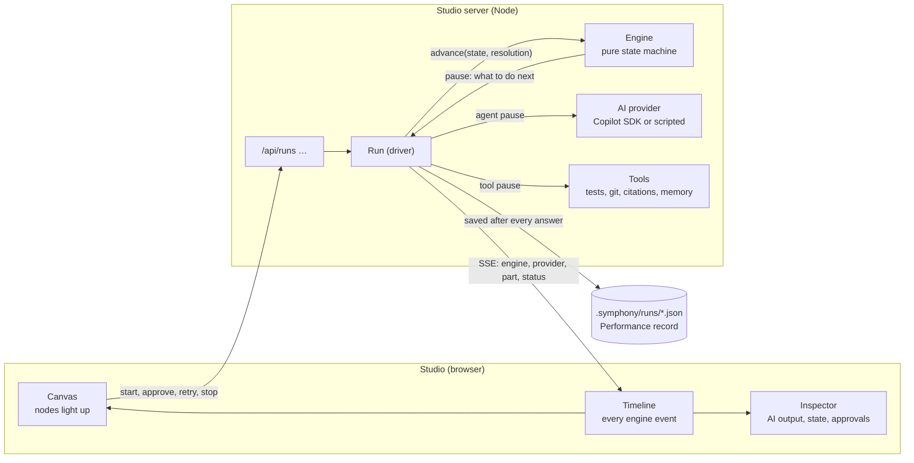

# How Symphony Studio works

The studio is a **viewer and remote control for the engine**. It does not decide anything:
the engine decides what runs next, what is accepted and what is recorded. The studio
shows what the engine did, as it does it, and sends your decisions back.

## Who keeps track: the engine, not the AI

Every AI step starts with an empty context. It sees only the input the engine picks for it
(the fields the step `reads`) and may only change the fields it declares (`writes`). It
remembers nothing between steps. So the AI cannot be the source of truth, and nothing an
agent *says* it did counts until the engine has checked it.

The engine (`src/core/engine.ts`) is a pure function: `advance(score, state, resolution)`
returns the next state and the next **pause** (the work to do now: an AI step, a tool, an
approval). It does no I/O. The driver (`src/runtime/driver.ts`) plays each pause (it calls
the AI or runs the tool) and hands the answer back to `advance`. Every transition goes into
the run's **Performance** record:

| In the record | What it is for |
|---|---|
| `steps[]` | One entry per step: node, input, the accepted updates, the state hash before and after, the transcript (prompt, output, tool calls, tokens, model, files the engine read into the prompt). |
| `attempts[]` on a step | Every *rejected* answer, with the reasons it was rejected. A lie that was caught is still on file. |
| `events[]` | Paused, resumed, response-rejected, recovered, finished: the timeline you scrub. |
| `moveKey` | `(moveType, targetSite, stateHash)`: the same move from the same state is never played twice (no infinite loops). |
| `finalState`, `outcome` | Where it ended: `success`, `partial` (ended honestly with open doubts), `failed`. |

Because `advance` is pure, a saved run can be **replayed**: the engine runs again on the
recorded answers and must reach the same state hashes. `cli verify <run.json>` and opening a
saved run in the studio both do this.

## How a lie or a failure is caught

No single layer catches everything; each one closes a different gap.

| Layer | What it catches | Where |
|---|---|---|
| Shape | An answer that is not a valid `MoveVerdict` with typed `updates`, or writes a field the step may not write. Rejected before state changes; the AI is told why and tries again (bounded). | `src/core/schema.ts`, the engine |
| Acceptance checks | Pattern rules as expressions: "triage every file of the batch", "one ruling per hypothesis", "cite only F-ids that exist", "at most 5 objections". | `checks` on a node |
| Permissions | Assessors are read-only: a command that writes is refused before it runs, and the refusal is recorded. Executors work in a worktree. | `src/runtime/provider.ts` |
| Engine-run tools | "Tests pass" is not taken from the AI: the engine runs the tests, captures the diff, and notices when an edit changed nothing. | `tests.run`, `git.diff` |
| Citations | Every ``path:line — fact `quote` `` is checked against the file: the file exists, the line exists, the quote is there. Failures go to `unverified`, not into the answer. | `evidence.check` |
| Debate | A skeptic attacks the draft, a pragmatist triages the objections, a second investigator answers independently (by complexity). | `src/patterns/phases/debate.ts` |
| People | Approvals at the points that matter (diagnosis, plan, go-gate). | `approval` nodes |

What is *not* caught automatically: a claim that is true of the cited line but wrong about
the system (the quote exists, the reasoning is bad). The debate and the approvals are there
for that, and the record lets you find it afterwards.

## Following a run in the studio

The studio subscribes to `/api/runs/:id/events` (server-sent events). Each message has a
sequence number, so a reconnect continues where it stopped, and switching to a run replays
its stream from the start.

| Message | What the studio does with it |
|---|---|
| `engine` | Lights the node (active, waiting, done, failed), moves the data packet along the edge just taken, updates **State** and the **Timeline**. |
| `provider` | Streams the AI's text, reasoning, tool calls and permission decisions into **AI output** for that step. |
| `part` | A fanned-out step plays several sub-agents at once. Each one appears as its own **sub-agent node** next to the step (waiting, running, done, failed, kept from a retry), with its own stream labelled "🤖 Sub-agent n". |
| `overtime` | A step ran past its time limit: you choose to keep waiting, or stop it and keep what it has. |
| `status` | Running, paused, stuck, done. |
| `performance` | The record was saved; the result appears at the top of the inspector. |

The **minimap** lights the same nodes as the canvas. While a run is live you can drag nodes
to see better, but connections are locked: the score is the read-only plan, so it cannot
change mid-run.

## Stopping, retrying and resuming

| You want to | Do this | What the engine does |
|---|---|---|
| Look at an answer before it is applied | **Breakpoint** (the dot on a node) or **step mode** | Pauses after the AI answered, before `advance` applies it: you see the proposed JSON. |
| Stop now | **Stop** | Aborts the live AI call, keeps its partial output, saves the run. |
| Retry a stuck step | **↻ Retry step** (optionally with a hint and a smarter tier) | A fresh set of attempts. In a fanned-out step, the sub-agents that already passed are kept (`partsDone`); only the others play again. |
| Continue later | **▶ Resume** or `cli resume <file>` | Continues from the last checkpoint; a run that is still live is followed, not copied. |
| Redo from step N | **⑂ Fork from step N** or `cli fork <file> --at N` | Keeps the steps before N and plays the rest as a new run. |
| Compare two runs | `cli compare a.json b.json` | Finds the first step where they diverge and says why: plan, environment, AI, human or engine. |

## Where things live

| Path | What |
|---|---|
| `src/core/` | The engine, expressions, validation, replay. Pure and browser-safe: the studio imports it through the `@core` alias. |
| `src/runtime/` | All I/O: the driver, providers, tools, memory, the run store. |
| `src/patterns/` | The pattern library, in TypeScript. |
| `packages/ui/` | The studio (React Flow) and its dev server (`packages/ui/server/api.ts`). |
| `.symphony/runs/` | Saved runs (Performance records), resumable and replayable. |
| `.symphony/memory.json` | Facts, lessons and approved compositions remembered across runs. |

See also: [the maestro](./maestro.md) and [the algorithm flows](./patterns.md).
